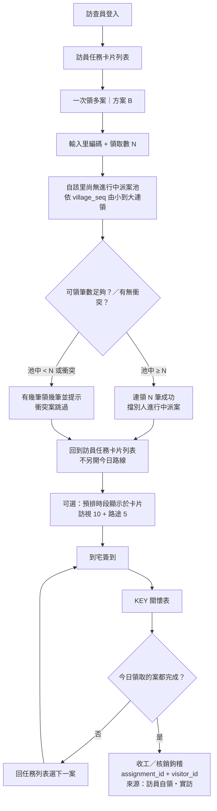

# 訪查員自領多案流程｜依里編號連領（方案 B）

**方案 B：訪員自領多案**讓訪查員在實地訪查時，輸入里編碼（六碼，如 `040051`）與領取數 N，系統從該里「尚無進行中派案」池中，依 `village_seq`（里編號）由小到大連領最多 N 筆（非真隨機）；領案後直接回到既有「訪員任務」卡片列表（**無「今日路線清單」**），卡片上可選顯示預排時段（訪視約 10 分＋路途約 5 分），再逐案到宅簽到、KEY 關懷表，並以 `assignment_id`＋`visitor_id` 做核銷鉤稽；來源標記為**訪員自領・實訪**（資料來自個案名冊 `village_code`／`village_seq`／`case_id`，派案表擋別人已有進行中派案）。

> 可分享海報：[`assets/visitor-self-claim-batch-flow.html`](./assets/visitor-self-claim-batch-flow.html)

## 流程圖（Mermaid）

## 如何操作

- **輸入**：里編碼（六碼，如 `040051`）＋領取數 **N**。
- **連領規則**：從該里「尚無進行中派案」池，依 `village_seq` **由小到大**連領（不是真隨機）；派案表會擋別人已有進行中派案。
- **不足 N 筆**：建議「有幾筆領幾筆」並提示實際領取數；衝突案跳過。
- **領案後**：直接回「訪員任務」卡片列表；**不要**走「今日路線清單」。
- **實訪循環**：到宅簽到 → KEY 關懷表 → 回列表下一案；來源標記為**訪員自領・實訪**。
- **資料／鉤稽**：個案名冊（`village_code`、`village_seq`、`case_id`）；核銷鉤稽鍵 `assignment_id`＋`visitor_id`。
