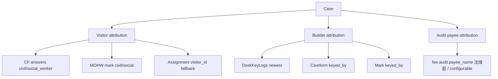

# 訪查員／建檔人員計費統計計畫

> **狀態**：產品決策全部鎖定（含 §8.4）；**開發中**（2026-11-25）。  
> **Canonical**：本檔為正式計畫。  

> **技術路線**：沿用個案進度歸因（`CaseProgressModule`）＋新建管理者統計頁；**費率／調整規則一律讀設定層，禁止硬編碼為唯一真相。**  
> **費率來源**：衛福部／擴大獨居老人訪查作業費用簡表（官方圖表，見 §2.2）。

---

## 1. 目標與使用者

### 目標

- 讓區承辦可依日期／里／角色，查詢**訪查員**與**建檔人員**的件數與（後續）計費金額。
- 支援核銷前對帳、稽核件數合理性檢查，以及「建檔費 vs 訪視費 vs 行政稽核費」分開請款。
- Phase 1 先交付**件數＋形態分欄**；金額在費率表填妥後才正式計算。

### 使用者與權限

| 項目 | 決策 |
|------|------|
| 使用者 | 區承辦／`workspace_owner`／`workspace_manager` |
| RBAC | 與個案進度儀表板同級：`payments.read` + `workspace_owner \| workspace_manager` |
| 文案 | 一律使用「**訪查員**」（不用志工／訪員） |

---

## 2. 已鎖定決策（使用者確認 2026-11-25）

| # | 議題 | 鎖定內容 |
|---|------|----------|
| 1 | 官方費率表（簡表內三種結果） | 見 §2.2：成功 **250**／未遇 **150**／拒訪 **60**（實地訪視＋建檔＋行政稽核三線加總）。**禁止硬編碼為 live 唯一來源** → 見 §2.1。 |
| 2 | 未遇計件 | 計為 **1 案**（對齊現行「一張關懷表結案」政策），**不是**三次戳記 ×3。 |
| 3 | 同案社政＋民政 | **LOCKED：`each_full_visit_fee`（各發／都要發）** — 成功案各發訪視費 **180**；**不是**只發主訪／平分。→ §2.3。 |
| 4 | 建檔費 vs 訪視費 | **分開**請款；同一人**可以兩邊都領**（若同時是訪查員＋建檔人）。 |
| 5 | 建檔費／資料處理費受款人 | **LOCKED：只給建檔人**（`rule.builder_fee_only_to_builder=true`）。**覆寫**先前「處理費兩邊都要／每 track 各加一次」假設。訪視側**不加**建檔／處理費。 |
| 6 | 行政稽核費 | 簡表第三條；金額 40／30／10。**受款人 LOCKED**：初始固定 **沈煒庭**（審核／角色提示「審」）；之後可經 `計費參數`／Manager 改為課長等，免改 code。→ §2.3、§2.5。 |
| 7 | 簡表外形態（查無／住址不詳／直 KEY／僅建檔） | **全部可計費**（不排除）。費隨該案／通道**紀錄內容**走。查無／住址不詳預設對齊未遇費率（可改 Sheet）；直 KEY 依 mark `outcome`；僅建檔只發建檔費線。→ §2.5。 |
| 8 | 稽核門檻 | 「稽核通過才計費」為 **toggle 設定**，預設 **OFF**（先計件／計費不強制稽核）；之後可開啟。 |
| 9 | 日期欄位 | **全部保留**可供篩選／顯示：`visit_date`／送出／稽核／KEY／回報；篩選器可選「依哪個日期欄」。 |
| 10 | 設定層驅動 | **強制**：所有單價與調整規則存 Google Sheets 設定層；Phase 2 上線後**改單價不必 redeploy 程式**。→ §2.1。 |
| 11 | 補助上限（簡表注意事項） | solo **250**／joint **500** 寫入 `rule.cap.*`。**LOCKED：不硬砍、不比例折減、不擋發**；僅 UI soft warning。→ §2.4。 |

### 2.2 官方費用簡表（LOCKED — 來源圖）

**標題**：擴大獨居老人訪查作業費用簡表

| 費用項目 | 訪視成功 | 訪視未遇 | 拒訪 | Config keys |
|----------|--------:|--------:|-----:|-------------|
| 實地訪視費 | **180** | **100** | **30** | `fee.visit.success`／`fee.visit.missed`／`fee.visit.refused` |
| 建檔費 | **30** | **20** | **20** | `fee.builder.success`／`fee.builder.missed`／`fee.builder.refused` |
| 行政稽核費 | **40** | **30** | **10** | `fee.audit.success`／`fee.audit.missed`／`fee.audit.refused` |
| **總金額** | **250** | **150** | **60** | （三線加總；非獨立參數） |

簡表注意事項（寫入規則層）：

| 規則 | 金額 | Config key |
|------|-----:|------------|
| 民政人員「獨自訪視」每案補助上限 | 250 | `rule.cap.solo_visit_case=250` |
| 「共同訪視」（志工、社福、其他非公所人員）每案補助上限 | 500 | `rule.cap.joint_visit_case=500` |

> **簡表未列但已鎖定預設**：查無此人、住址不詳、直 KEY、僅建檔 → 全部可計費；映射與規則見 §2.5（非排除）。

### 2.3 使用者澄清（覆寫先前模糊項）— LOCKED

1. **社政＋民政：各發訪視費（都要發）**  
   - Mode：**`rule.dual_civil_social=each_full_visit_fee`**（LOCKED）。  
   - **不是**只發主訪；**不是**平分；有社政＋民政 → **兩邊都要發**。  
   - 成功各 180；未遇／拒訪各發對應訪視費（100／30），同樣「各發 full visit fee」語意。

2. **資料處理費／建檔費：只給建檔人**  
   - **`rule.builder_fee_only_to_builder=true`**（LOCKED）。  
   - 訪查員 track **不含**建檔費／處理費。  
   - 先前「處理費兩邊都要／每 track ×30」**作廢**；建檔費即簡表「建檔費」線（成功 30／未遇 20／拒訪 20），受款人＝建檔歸因人。

3. **行政稽核費為第三應付線**  
   - 金額鎖定如上表（40／30／10；形態外預設見 §2.5）。  
   - **受款人 LOCKED（初始）**：審核／**沈煒庭**（record name `沈煒庭`，role hint「審」）。  
   - **之後可設定**：`fee.audit.payee_name`／`fee.audit.payee_role`（或等價鍵）經 `計費參數`／Manager 設定改為**課長**等；**改受款人不必改 code**。

### 2.4 共同訪視 500 上限 — soft warning only（LOCKED）

官方成功案「單線三項加總」＝ 180＋30＋40＝**250**（獨自訪視參考上限）。  
社政＋民政各發訪視費時，訪視線已 **360**，再加建檔＋稽核會超過 250；此時以 **共同訪視參考上限 500** 做對照（若該案認定為共同訪視；判定見 §8.4）。

**Cap 行為 LOCKED（使用者：「應該不會有超過呀」）：**

| 規則 | 鎖定 |
|------|------|
| 硬砍／比例折減／擋發 | **不做** |
| 超過 `rule.cap.joint_visit_case`（500）或 solo（250） | UI **soft warning** 僅供 ops 察覺 |
| Cap 數字用途 | 顯示／驗證警告；**不**自動調降應付金額 |
| Config | 仍保留 `rule.cap.solo_visit_case`／`rule.cap.joint_visit_case` 供警告閾值 |

**成功 × 共同訪視（社政＋民政各發）示意：**

| 線項 | 計算 | 小計 |
|------|------|-----:|
| 實地訪視費 | 社政 180 ＋ 民政 180（都要發） | **360** |
| 建檔費 | 只給建檔人 1 次 × 30 | **30** |
| 行政稽核費 | 1 次 × 40 → 沈煒庭（可改設定） | **40** |
| **案內加總** | | **430** |
| `rule.cap.joint_visit_case` | 參考上限 500 | 430 ≤ 500 → 無警告；**全額發 430** |
| 若再疊其他共同訪人員使加總 > 500 | | **仍全額發**；UI soft warn only |

**獨自訪視成功示意（單側訪查員）：** 180＋30＋40＝**250**＝solo 參考上限正好滿額。

### 2.5 簡表外形態與通道 — 全部可計費（LOCKED）

> 使用者：「依照裡面的內容給經費」「不是都需要嗎」→ **查無／住址不詳／直 KEY／僅建檔皆應付**，不排除；費隨紀錄內容／結果走。

| 形態／通道 | 計費規則（LOCKED） | Config／備註 |
|------------|-------------------|--------------|
| **直 KEY** | 依 mark `outcome` 映射成功／未遇／拒訪三線；訪視費給歸因訪查員；建檔費**僅當有建檔人**；稽核費依規則給設定受款人 | 無獨立「直 KEY 專用單價」；走既有 `fee.*.success|missed|refused` |
| **僅建檔** | 只發**建檔費**線，依該案訪視結果形態（成功 30／未遇 20／拒訪 20）；**不發訪視費給建檔人**（除非同一人也是訪查員） | `fee.builder.*`；無結果時引擎需有 fallback（建議對齊未遇建檔費 20，可寫入 `fee.builder.builder_only_fallback`） |
| **查無此人** `not_found` | 可計費；官方僅三欄 → **預設對齊訪視未遇**：訪視 100／建檔 20／稽核 30 | `fee.visit.not_found`／`fee.builder.not_found`／`fee.audit.not_found`，種子預填＝未遇；**ops 可改 Sheet 免改 code** |
| **住址不詳** `addr_unknown` | 同上，預設＝未遇三線 | `fee.*.addr_unknown`，種子＝未遇；可改 Sheet |

> **預設映射已鎖定**：查無／住址不詳＝未遇金額，除非使用者日後在 `計費參數` 改成不同數字。禁止靜默改成拒訪或 0。

### 2.6 短例：應付示意（LOCKED 規則下）

| 情境 | 訪視費 | 建檔費 | 稽核費 | 備註 |
|------|-------:|-------:|-------:|------|
| 單側成功＋有建檔人 | 訪查員 180 | 建檔人 30 | 沈煒庭 40 | 案內 250 |
| 社政＋民政成功＋有建檔 | 社政 180＋民政 180 | 建檔人 30 | 沈煒庭 40 | 案內 430；≤500 無警告 |
| 單側未遇＋有建檔 | 訪查員 100 | 建檔人 20 | 沈煒庭 30 | 案內 150 |
| 查無／住址不詳（預設） | 訪查員 100 | 建檔人 20（若有） | 沈煒庭 30 | 對齊未遇；可改 Sheet |
| 直 KEY・outcome=成功＋有建檔 | 歸因訪查員 180 | 建檔人 30 | 沈煒庭 40 | 依 outcome；無建檔人則無建檔費 |
| 僅建檔・案結果=成功 | —（建檔人非訪員） | 建檔人 30 | 依規則 | 不發訪視費給純建檔人 |
| 拒訪單側＋有建檔 | 訪查員 30 | 建檔人 20 | 沈煒庭 10 | 案內 60 |

### 2.1 設定層驅動設計（強制 — Config-driven）

> **硬性要求**：所有費用金額與相關調整規則必須落在 **settings／config 層**，讓 ops 可不改程式就調參數。  
> Phase 2 上線後：**變更單位單價不需要 code deploy**（改 Sheet 即可；GAS／Next 只讀設定）。

#### 可設定項目（禁止硬編碼為 live 唯一真相）

| 設定鍵 | 說明 | 鎖定預設／備註 |
|--------|------|----------------|
| `fee.visit.success` | 實地訪視費・成功 | **180** |
| `fee.visit.missed` | 實地訪視費・未遇 | **100** |
| `fee.visit.refused` | 實地訪視費・拒訪 | **30** |
| `fee.builder.success` | 建檔費・成功 | **30**（只給建檔人） |
| `fee.builder.missed` | 建檔費・未遇 | **20** |
| `fee.builder.refused` | 建檔費・拒訪 | **20** |
| `fee.audit.success` | 行政稽核費・成功 | **40** |
| `fee.audit.missed` | 行政稽核費・未遇 | **30** |
| `fee.audit.refused` | 行政稽核費・拒訪 | **10** |
| `fee.audit.payee_name` | 行政稽核費受款人姓名 | **LOCKED 初始：`沈煒庭`**；可改 Sheet／Manager（例改課長）免 deploy |
| `fee.audit.payee_role` | 行政稽核費受款角色提示 | **LOCKED 初始：`審`**（審核）；可設定 |
| `fee.visit.not_found` | 查無・訪視費 | **100**（預填＝未遇；可改） |
| `fee.builder.not_found` | 查無・建檔費 | **20**（預填＝未遇；可改） |
| `fee.audit.not_found` | 查無・稽核費 | **30**（預填＝未遇；可改） |
| `fee.visit.addr_unknown` | 住址不詳・訪視費 | **100**（預填＝未遇；可改） |
| `fee.builder.addr_unknown` | 住址不詳・建檔費 | **20**（預填＝未遇；可改） |
| `fee.audit.addr_unknown` | 住址不詳・稽核費 | **30**（預填＝未遇；可改） |
| `fee.builder.builder_only_fallback` | 僅建檔且無結果時建檔費 | 建議 **20**（對齊未遇建檔費） |
| `rule.dual_civil_social` | 同案社政＋民政 | **`each_full_visit_fee`**（LOCKED；都要發） |
| `rule.builder_fee_only_to_builder` | 建檔費只給建檔人 | **`true`**（LOCKED） |
| `rule.cap.solo_visit_case` | 獨自訪視參考上限（警告用） | **250**；**不硬砍** |
| `rule.cap.joint_visit_case` | 共同訪視參考上限（警告用） | **500**；**不硬砍／不折減／不擋發** |
| `rule.cap.overrun_mode` | 超額行為 | **`soft_warn_only`**（LOCKED） |
| `fee.require_audit_pass` | 稽核通過才計費 | **OFF**（`false`） |
| `fee.rate_card.version` | 費率卡版本號 | 例 `2026-YH-official-v1` |
| `fee.rate_card.effective_from` | 本版生效日（含當日） | ISO date；換版用 |

> **已廢止／勿再種子**：`fee.data_processing.apply_visit_track=true`、每 track 各加處理費、`fee.dual_side_mode=split|primary_only` 作為預設。舊文件若提及「處理費兩邊都要」以本節為準。

#### 存放位置（對齊本專案：Sheets + GAS + Next.js）

| 層級 | 角色 | 決策 |
|------|------|------|
| **Source of truth（live）** | Google Sheet 分頁 **`計費參數`**（建議獨立 tab；勿只塞進 `_設定` 的三欄結構） | Ops 已習慣改 Sheets；`WorkerFeeStatsModule`／`PaymentModule` 以 SpreadsheetApp 讀取 |
| **Fallback only** | `lib/domain/payments.ts`（或新建 `lib/domain/fee-rate-defaults.ts`） | **僅** typed defaults／離線預覽／Sheet 缺列時的安全後備；**絕不可**當正式核銷唯一來源 |
| **讀取路徑** | GAS 模組讀 Sheet → API 回傳目前生效費率卡（含 version／effective_from）→ Next 顯示與試算 | 前端不自己發明單價 |
| **Manager UI** | Phase **2a**：Sheet-only 編輯即可上線調價；Phase **2b**（後續）：簡單設定表單寫入**同一** `計費參數` tab | UI 是便利層，不是第二套真相 |

與既有 `_設定`（`key`／`value`／`description`）的關係：工作區級參數仍可留在 `_設定`；**計費費率卡因需 unit／note／audit 欄與版本列，獨立 `計費參數` tab**，避免把 `_設定` 塞爆或欄位不一致。

#### Sheet schema：`計費參數`

第 1 列英文 key、第 2 列中文標題（對齊 `docs/sheets/schema-overview.md` 慣例）。

| 英文 key | 中文 | 型別 | 必填 | 說明 |
|----------|------|------|------|------|
| `key` | 參數鍵 | text | ✅ | 例 `fee.visit.success` |
| `value` | 值 | text | ✅ | 數字或 enum 字串（讀取時依 key 轉型） |
| `unit` | 單位 | text | | 例 `NT$`／`bool`／`enum`／`date`／`version` |
| `note` | 備註 | text | | 業務說明、適用範圍 |
| `updated_at` | 更新時間 | datetime | | 最後修改 |
| `updated_by` | 更新者 | text | | 承辦姓名或 email |
| `effective_from` | 生效起日 | date | ✅* | 該列所屬費率卡版本的生效日；缺省則視為「目前版本」 |
| `rate_card_version` | 費率卡版本 | text | ✅* | 與 `fee.rate_card.version` 對齊；同版多列共用 |

\* 實作可採兩種列型態之一（擇一寫死在模組，文件化即可）：

1. **扁平 key-value**：每一參數一列，另以 `fee.rate_card.*` 列標示目前版本；歷史版可另開「封存區」或保留舊列但標 `effective_from` 區間。  
2. **多版並存**：同一 `key` 可有多列不同 `rate_card_version`／`effective_from`；引擎依「查詢／批次日 ≤ 今天且最大 effective_from」解析。

**建議採 2（多版並存）**，以便換價不刪舊列、利於稽核。

Bootstrap／`SheetHelper`：Phase 2 實作時於 `ensureColumns`／一鍵建置加入 `計費參數` 種子列（含 §2.2 官方單價、`fee.*.not_found`／`fee.*.addr_unknown`＝未遇預填、稽核受款人 `沈煒庭`／`審`、`rule.dual_civil_social=each_full_visit_fee`、`rule.builder_fee_only_to_builder=true`、兩項 cap、`rule.cap.overrun_mode=soft_warn_only`、`require_audit_pass=false`）；**此為計畫允許的「極小 config stub」範圍**，非完整產品功能。

#### 版本與歷史批次（不可改寫已產生核銷）

| 規則 | 說明 |
|------|------|
| 換價不回溯 | 變更 `計費參數` **不得**重算或覆寫已產生的 payment run／批次列金額 |
| 批次快照 | 產生應付／payment batch 時，將當下解析到的單價、三線費、dual／builder／cap 規則、`require_audit_pass`、`rate_card_version` **快照寫入批次列**（或批次 header JSON） |
| 報表試算 | 統計頁「試算金額」讀**當下生效**費率卡；標示版本號；與已鎖定批次並列時以快照為準 |
| 生效日 | 以 `effective_from`（或版本列）決定「哪一張卡」適用於選定的統計日期欄 |

#### 明確聲明：無需部署即可改單價

- **Phase 2 交付完成後**：ops 在 Google Sheet `計費參數` 改單位單價／規則／toggle → 下一筆讀取即生效（或依 `effective_from` 排程生效）。  
- **不需要**改 `lib/domain/payments.ts`、不需要 clasp／Vercel redeploy，即可完成調價。  
- 僅當新增「從未支援的形態代碼／新 enum 值／新計算公式」時才需要程式變更與部署。

#### 與現況硬編碼的遷移態度

- 今日：`PaymentModule` 固定 180+30；`lib/domain/payments.ts` 同值（未拆建檔／稽核線、未分未遇／拒訪）。  
- Phase 2：改為讀 `計費參數`；上述常數降級為 fallback／種子預設（對齊官方簡表三線）。  
- Phase 3 銜接舊 `VISIT-FEE` 批次時，舊列保留其當時寫死金額；新按人批次一律帶 rate-card 快照。

---

## 3. 現況研究結論（實作依據）

### 3.1 已有核銷能力（與本需求落差大）

| 機制 | 位置 | 行為 | 缺口 |
|------|------|------|------|
| 訪視費批次 | `gas/src/modules/PaymentModule.gs` `visitItemsFromIndex` | 僅「已稽核＋稽核通過」關懷表，`case_id` 去重；固定 **訪視費 180 + 資料處理費 30** | 歸到 `visitor_id='VISIT-FEE'`，**無按人分攤**；未對齊簡表三線／未遇／拒訪 |
| 前端費率常數 | `lib/domain/payments.ts` | 同上 180／30；說明「未遇、拒訪或不完整需督導判定」 | 無形態細分、無建檔費、無行政稽核費 |
| 志工車馬費 | `lib/domain/volunteer-transport-fees.ts` | 出勤時數級距／送餐次 | **與衛福關懷訪視件數無關** |
| 核銷資格 | `lib/domain/visits.ts` `getPaymentEligibility` | 僅「訪視成功」且有同意可直接核銷；未遇不可直接核銷 | 未定義建檔／稽核／直 KEY 費 |
| 桌面登打件數 | `gas/src/modules/DeskClerkModule.gs` `stats` | 依 `紙本登打紀錄` 計 `key_count`／`piece_count`（同案第二次「未遇」`counts_as_piece=0`） | 僅 TEMP 登打，未接訪員側、未接費率 |

### 3.2 已有「按人」歸因（可直接重用）

`gas/src/modules/CaseProgressModule.gs` 詳情彙總：

- **社政訪員／民政訪員**：關懷表 answers 的 `social_worker_*`／`civil_worker_*`，不足時回退 `MOHW進度個案標記`
- **建檔人員優先序**：**桌面 TEMP（`紙本登打紀錄`）→ 關懷表 KEY（`keyed_by_name`／`keyed_source`）→ 直 KEY（mark `keyed_by_*`）**
- UI 已在 `components/manage/case-progress-dashboard.tsx` 顯示這三欄，但**沒有按人聚合件數／金額**

### 3.3 訪視結果語彙（系統實際值）

- 關懷表列：`visit_result`（完成／未遇／拒訪等，見 `docs/sheets/schema-overview.md`）
- answers：`visit_status`（已完成／拒絕訪視／查無此人／住址不詳／未遇戳記等）
- 名冊：`Cases.visit_status`（待訪／已完成／空訪／進行中…）
- 直 KEY：`MOHW進度個案標記.outcome`
- 產品政策（`AGENTS.md`）：未遇＝一張關懷表結案＋三次時間備註；住址不詳＝一張表即可、不要求三次再訪

### 3.4 風險資料現況

- 殭屍派案已清理（`docs/ops/zombie-assignments-close-D-2026-11-24.md`），統計仍應排除 `退回`／作廢
- Primary 直 KEY 無 eligible 關懷表仍大量存在；重複 KEY／僅姓名匹配為已知坑（`LESSONS.md`）
- 統計單位以 `case_id` 為主鍵；join **禁止**依賴 `encoded_id`

---

## 4. 查詢維度

### 篩選

| 維度 | 說明 |
|------|------|
| 日期區間 | 必填起迄 |
| 日期欄位選擇 | 可選：`visit_date`／送出（`submitted_at`）／稽核（`audited_at`）／KEY（`keyed_at`）／回報（`reported_at` 等 mark 時間） |
| 里 | 可多選或單一 |
| 角色 | 社政／民政／訪查員（顯示用）；後續可含建檔／稽核受款 |
| 模式 | **訪員報表** vs **建檔報表**（可切換或並排）；稽核費線可另欄或第三模式 |
| 稽核門檻 | 讀取全域／工作區 toggle「稽核通過才計費」（預設 OFF） |

### 每人列

- 姓名／人員 id
- 各訪視形態件數（分欄）
- 費率列與小計（Phase 2；依 track：訪視／建檔／稽核）
- 同案雙側標註（若適用）

### 明細下鑽

- 可下鑽到 `case_id`／`careform_id`／`mark_id`／`log_id`
- 明細列應顯示所選日期欄的實際值，便於對帳

---

## 5. 訪視形態 taxonomy

對齊現有欄位；**簡表內三種結果單價已鎖定**；簡表外形態**全部可計費**，預設見 §2.5。

| 形態代碼 | 中文 | 判定來源（優先） | 計件規則 | 訪視費 | 建檔費（只給建檔人） | 行政稽核費 |
|----------|------|------------------|----------|--------|---------------------|------------|
| `success` | 訪視成功 | CF `visit_result`／answers「已完成」 | 每案 1 | **180** | **30** | **40** |
| `missed` | 未遇 | CF／答案未遇 | **每案 1**（非 ×3 戳記） | **100** | **20** | **30** |
| `refused` | 拒訪 | 拒訪／拒絕訪視 | 每案 1 | **30** | **20** | **10** |
| `not_found` | 查無此人 | visit_status／outcome | 每案 1；**可計費** | **100**（＝未遇預設；`fee.*.not_found`） | **20** | **30** |
| `addr_unknown` | 住址不詳 | 同上 | 每案 1（不要求三次再訪）；**可計費** | **100**（＝未遇預設；`fee.*.addr_unknown`） | **20** | **30** |
| `direct_key` | 直 KEY | 有 mark、無 eligible CF（或明確直 KEY 通道） | 每案 1；**可計費** | 依 mark `outcome`→成功／未遇／拒訪 | 有建檔人才發（依 outcome） | 依 outcome |
| `desk_piece` / `builder_only` | 僅建檔 | `紙本登打紀錄.counts_as_piece=1` 或建檔 track 去重件 | 每案最多 1 建檔件 | —（純建檔人不領訪視費） | 依案結果 30／20／20 | 依規則 |

### 報表兩層結構

1. **結果形態**：success／missed／refused／not_found／addr_unknown（訪視結果）
2. **通道**：關懷表 KEY／直 KEY／桌面 TEMP（建檔來源）

同一案可同時有「結果形態」（訪視側）與「建檔通道」（建檔側）；因建檔費與訪視費**分開**，兩邊可同時計入不同 track。行政稽核費為第三 track（受款人可設定；初始沈煒庭）。

### Phase 1 金額行為

- 以件數為主。
- 金額欄：簡表內＋簡表外（預設映射）均可試算鎖定單價；標明非正式。
- 可選預覽：標明非正式；**正式計費以 Phase 2 `計費參數` 為準**。

---

## 6. 歸因規則（寫死）

### 訪員報表

- 一案可同時列入社政與民政各一列（雙人同案）。
- 同人同案以 `case_id` 去重，避免雙計。
- 同案雙側發放：**LOCKED `each_full_visit_fee`** — 各發完整訪視費（**都要發**）；報表標註「同案雙側」。  
- 訪員 track **不含**建檔費（`rule.builder_fee_only_to_builder=true`）。

### 建檔報表

- 沿用 CaseProgress 優先序：桌面 TEMP → 關懷表 KEY → 直 KEY。
- `counts_as_piece` 用於桌面計件；關懷表／直 KEY 無 piece 旗標時以「每案最多 1 建檔件」去重。
- 建檔費與訪視費分開；**建檔費只發建檔歸因人**；同一人可同時出現在兩張報表並各自領取（訪視線＋建檔線）。
- **僅建檔**：只發建檔費線（依案結果）；不發訪視費給純建檔人。

### 行政稽核費 track

- 依結果形態取 `fee.audit.*`（含 `not_found`／`addr_unknown` 預設＝未遇）。
- 受款人：**初始固定 `沈煒庭`**（`fee.audit.payee_name`；role hint `審`）；可經 `計費參數`／Manager 改課長等，免改 code。

### 直 KEY

- 無關懷表仍納入 fee engine；**可計費**。
- 費率依 mark `outcome` 映射成功／未遇／拒訪三線；訪視費給歸因訪查員；建檔費僅當有建檔人；稽核費給設定受款人。
- 不要求補關懷表才可計費（已鎖定）。

### 稽核 toggle

| 設定 | 預設 | 行為 |
|------|------|------|
| `requireAuditPassForFee` / `fee.require_audit_pass` | **OFF** | OFF：符合形態規則即可計件／計費；ON：僅稽核通過者計入應付金額（件數報表仍可顯示未稽核，但標「未過稽核門檻」） |

### 排除

- `退回`／作廢關懷表、無效派案、明顯重複髒資料（依既有 index 規則）

---

## 7. UI／API 草圖（實作階段）

| 項目 | 規劃 |
|------|------|
| 路徑 | `/manager/worker-fee-stats` |
| 選單 | 「訪查員／建檔計費統計」 |
| 權限 | 同個案進度（見 §1） |
| 畫面 | 篩選列（含日期欄選擇、稽核 toggle 狀態提示）→ 人員列表 → 詳情抽屜 → CSV（Phase 3）；案內加總 > solo 250／joint 500 時 **soft warning**（不砍金額） |
| 後端 | 新 GAS `WorkerFeeStatsModule` + `lib/gas-client` + `/api/manager/worker-fee-stats/*`；費率讀 **`計費參數`**（§2.1） |
| 資料重用 | `VisitRecordIndex`／DeskKeyLogs／Marks；風格對齊 `CaseProgressModule` |
| 設定 | Phase 2a：Sheet；Phase 2b：可選設定表單寫同一 tab |

---

## 8. 仍開放／已關閉題

### 8.1 簡表未列形態 — **CLOSED**（見 §2.5）

全部可計費；查無／住址不詳預設＝未遇（`fee.*.not_found`／`fee.*.addr_unknown`）；直 KEY 依 `outcome`；僅建檔只發建檔費線。

### 8.2 行政稽核費受款人 — **CLOSED**（見 §2.3）

初始 **沈煒庭**（審）；之後 `計費參數`／Manager 可改課長等，免改 code。

### 8.3 共同訪視 500 cap 超額 — **CLOSED**（見 §2.4）

`rule.cap.overrun_mode=soft_warn_only`：不硬砍、不折減、不擋發；僅 UI soft warning。社政＋民政**都要發**訪視費。

### 8.4 「共同訪視」判定 — **CLOSED**（2026-11-25 試算確認）

試算：社政＋民政成功＋建檔＋稽核＝**430**；會超過 solo **250**，但不超过 joint **500**。若雙側案誤用 250 警示會長期誤報。

| 規則 | 鎖定 |
|------|------|
| 系統判定 | **同案同時有社政＋民政歸因** → 視為共同訪視 |
| soft-warn 閾值 | 雙側 → **`rule.cap.joint_visit_case`（500）**；單側 → **`rule.cap.solo_visit_case`（250）** |
| 各發 | 不受影響（仍各發 full visit fee） |
| 超額 | 仍 `soft_warn_only`（430 不警告；>500 才警告且不砍） |

---

## 9. 分階段交付

### Phase 1 — 件數統計

- 訪員／建檔兩模式、形態分欄、歸因、日期欄可選、下鑽明細
- 稽核 toggle：**顯示**設定意圖（預設 OFF）；若 Sheet 尚未建置可先讀 typed fallback
- 金額：簡表內形態可試算；簡表外「待設定」；標明非正式

### Phase 2a — Sheet 費率卡（正式金額；ops 可改 Sheet）

- 新增／種子 `計費參數` tab（schema 見 §2.1）；GAS `WorkerFeeStatsModule`／`PaymentModule` 讀取
- 種子官方三線單價、`fee.*.not_found`／`fee.*.addr_unknown`＝未遇、稽核受款人沈煒庭／審、`rule.dual_civil_social=each_full_visit_fee`、`rule.builder_fee_only_to_builder=true`、solo／joint cap、`rule.cap.overrun_mode=soft_warn_only`、`require_audit_pass=false`
- `rate_card_version` + `effective_from`；統計試算標示版本
- **改單價／改稽核受款人無需 code deploy**（本階段驗收條件）
- `lib/domain/*` 僅保留 typed defaults／fallback
- 正式金額小計（含三線＋cap soft-warn；**不**自動折減）

### Phase 2b — Manager 設定表單（可選後續）

- 簡單設定頁寫入**同一** `計費參數` Sheet（非第二真相）
- 權限：`payments.read` 同級或 `pricing.manage`／workspace_manager（實作時對齊 RBAC）

### Phase 3 — 匯出與核銷銜接

- CSV／薪資核銷匯出
- 產生 payment batch 時**快照**當下費率卡到批次列（禁止日後改價改寫歷史）
- 可選掛接既有 `payments.visitBatchPreview` 改為按人明細
- **不**取代志工車馬費流程

---

## 10. 風險

| 風險 | 影響 | 緩解 |
|------|------|------|
| Primary 直 KEY 量大且資料品質不一 | 建檔／直 KEY 件數膨脹或歸因偏差 | 明細可稽核；排除規則文件化；依 outcome 計費並可下鑽 |
| 雙側各發＋參考 cap | 加總可能 >500；業務以為會自動砍 | **LOCKED soft_warn_only**；UI 明示不自動折減；文件化 §2.4／§2.6 |
| 稽核費受款人改派 | 核銷對象過時 | 初始沈煒庭；改 `fee.audit.payee_name` 即可；批次快照當下受款人 |
| 簡表外形態金額爭議 | ops 以為查無不發 | 預設＝未遇已鎖定並種子；改數字免 code；禁止靜默改拒訪／0 |
| 費率硬編碼殘留 | ops 改 Sheet 無效、前後端金額不一致 | Phase 2 驗收：改 Sheet 即反映；常數僅 fallback；批次必快照 |
| 換價誤改歷史批次 | 核銷爭議 | `effective_from`／版本＋batch 快照；禁止重算已鎖定 run |
| 多日期欄混淆 | 篩選結果與業務認知不一致 | UI 明確標示「目前依○○日期」 |
| 姓名模糊匹配 | 建檔人錯歸 | 優先 id；禁止僅靠 encoded_id |
| 與舊 `VISIT-FEE` 批次並存 | 雙重核銷 | Phase 3 銜接時標註舊批次為「非按人」；遷移策略另案 |
| 共同訪視判定未定（§8.4） | soft-warn 用 solo 250 或 joint 500 可能不一致 | 雙側各發不受影響；判定確認前可對雙側案用 joint 閾值警告並標「判定待確認」 |

---

## 11. v1 範圍外

- 志工出勤車馬費級距、送餐次
- SaaS Pricing Engine 頁
- 自動匯款／銀行檔
- 修正 Primary 直 KEY 資料品質／回寫 `visit_status` 政策（另有 ops 文件）
- 訪查員自助「我的核銷」改版（仍用現有 `/visitor/payments`）
- 本階段不實作產品程式碼

---

## 12. 實作啟動檢查清單（確認開放題後可全開 Phase 2 金額）

1. [x] 官方簡表三線單價寫入計畫／將進 `計費參數` 種子（成功／未遇／拒訪）  
2. [x] 社政＋民政預設鎖定 **`each_full_visit_fee`**（都要發）  
3. [x] 建檔費只給建檔人（廢止「處理費兩邊都要」）  
4. [x] §8.1 簡表外形態：全部可計費；查無／住址不詳預設＝未遇；直 KEY 依 outcome；僅建檔只發建檔費  
5. [x] §8.2 行政稽核費受款：初始沈煒庭（審）；可設定改課長等  
6. [x] §8.3 cap 超額：`soft_warn_only`（不砍／不折減／不擋）  
7. [x] §8.4 共同訪視判定：雙側→500 警示／單側→250（試算 430 不誤報）  
8. [ ] 建立 task brief：`npm run task:new -- --title "訪查員建檔計費統計" --slug visitor-builder-fee-stats --ui`  
9. [x] Phase 1＋2a：`WorkerFeeStatsModule` + 管理者頁 + `計費參數`（GAS @189）  
10. [ ] 正式站 push 後驗收「改 Sheet 免 deploy」  
11. [ ] Design／UX 過場（對齊既有沉穩關懷語彙）；Phase 2b 設定表單另排  
12. [ ] `typecheck`／`lint`／`build`；`RELEASE-CHECKLIST.md`  
13. [ ] 可重用經驗寫入 `LESSONS.md`（含：費率真相在 Sheet、歷史批次快照、三線費用、soft-warn cap） |

---

## 變更紀錄

| 日期 | 說明 |
|------|------|
| 2026-11-25 | 初版：自 Cursor 計畫同步為 repo canonical；併入使用者鎖定決策與 TBD 單價／社政民政 callout |
| 2026-11-25 | 鎖定 **設定層驅動**：`計費參數` Sheet schema、可設定項、版本／批次快照、Phase 2a sheet-only／2b UI；明確「改單價免 code deploy」 |
| 2026-11-25 | **官方費用簡表鎖定**：visit／builder／audit 三線單價；`each_full_visit_fee`；建檔費只給建檔人；solo 250／joint 500 cap；合成例 430；開放題：簡表外形態、稽核費受款人、cap 超額與共同訪視判定。無獨立 Cursor plan 可同步 |
| 2026-11-25 | **關閉剩餘開放題**：簡表外形態全部可計費（查無／住址不詳預設＝未遇；直 KEY 依 outcome；僅建檔只發建檔費）；稽核費初始受款人沈煒庭（可設定）；cap `soft_warn_only`；補強社政＋民政都要發；新增 §2.5／§2.6 短例。僅 §8.4 共同訪視判定仍開放。無產品實作、無 commit |
| 2026-11-25 | **關閉 §8.4**：雙側社政＋民政 → joint 500 soft-warn；單側 → solo 250。授權開始開發 Phase 1＋2a。 |
